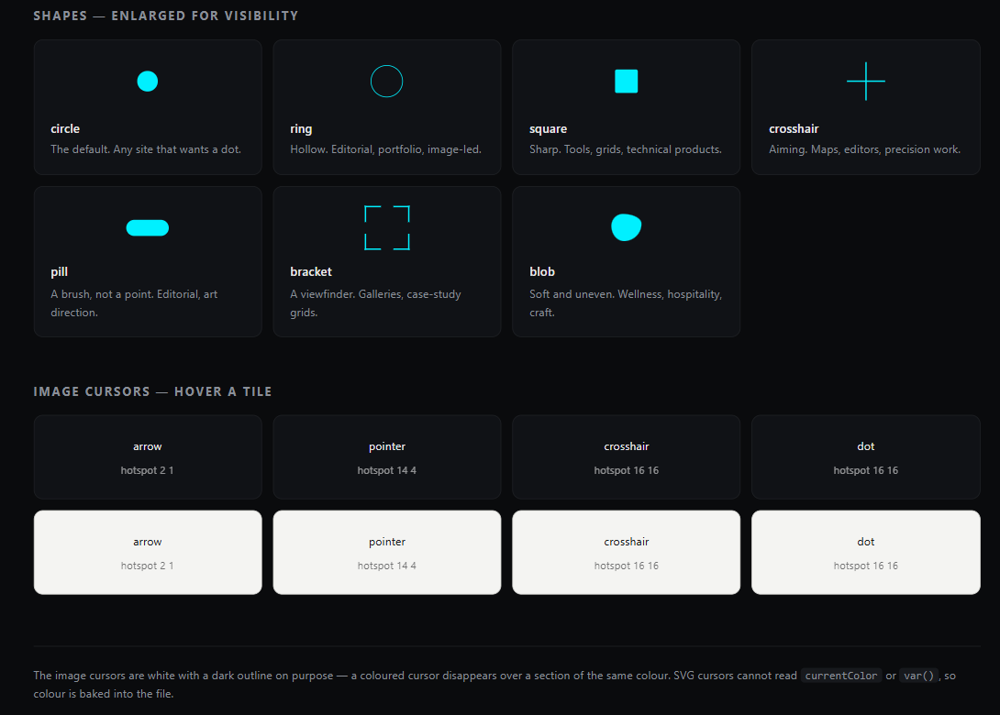

# cursorfit

### Fit the cursor to the site, not the site to the cursor.

Your site has a typeface, a palette, a spacing rhythm and a speed. The cursor is still the
system arrow. So you go looking for a cursor, find forty of them, and have no way to choose
except taste — which is exactly the thing that made the rest of the site good in the first
place.

**cursorfit reads your repo, scores its design character, and picks one cursor for it.** Then
it writes the code into the project, in your own colour token, at your own tempo.

It will also tell you when the right answer is no cursor at all.



---

## The part everyone skips

A custom cursor is a usability decision with a design budget attached. It replaces a control
the visitor has used since they were six. That costs something, and the cost is specific:

- It has to survive over text, images, glass, video, and a disabled button.
- It has to disappear on touch, and calm down under reduced-motion.
- It has to keep working when JavaScript loads late or not at all.
- And it has to look like it belongs to *this* site — not to the skill that generated it.

Most cursor skills sell the effect and leave you with the bill. This one is built the other way
round: audit first, verdict second, code last.

## What it actually does

```
read the repo  →  close the gaps  →  score  →  gate  →  pick one  →  implement  →  verify
```

1. **Reads** — framework, files, colour tokens, type stack, radii, spacing, keyframes,
   transitions, control count, media count, and any cursor code already there. Component tags
   count too: `<Button>`, `<Link>` and `<Image>` are not invisible.
2. **Closes the gap** — reports what it could not read (inline styles, utility classes,
   CSS-in-JS, component internals) and names the five files worth opening. Those get read by
   hand before anything is scored.
3. **Scores** five axes, each one requiring evidence from the code:
   `restrained ↔ expressive` · `precise ↔ organic` · `dense ↔ airy` · `calm ↔ energetic` ·
   `product ↔ editorial` — each with a confidence level.
4. **Measures** the motion signature — keyframe count, median transition, overshoot curves,
   scroll-driven animations, reduced-motion support, touch guards.
5. **Gates** — hard constraints that outrank the score. Glass panels kill blend modes. An
   unused GPU package kills the shader. Zero images kills the reveal.
6. **Asks** at most three questions, only where the code genuinely can't answer, each with a
   default so "I don't know" still produces a decision.
7. **Offers** three named slots instead of a gallery — **safe** (highest fit), **reach** (the
   most expressive family at most one tier up that still fits within 10 points), and
   **fallback** (the zero-JS answer). One of them gets built.
8. **Builds** the safe pick — or the reach, if you ask for it — as `cursor.css` + `cursor.js`,
   or a React component, wired to the site's existing tokens. Every build starts with the same
   state layer — link opens a ring, button becomes a capsule, a field hands the caret back — so
   no family ever ships a mark that ignores what it is pointing at. Then it checks its own work:
   greps, the build, and a real browser.

Nothing is invented at build time. The colour is a token that already exists. The speed comes
from the site's measured transitions. The size comes from its spacing.

## A real run

Run against a dark, animation-heavy AI product landing page — 86 files, 38 controls, 25
keyframes, median transition 200ms, and 177 inline styles the stylesheet scan could not read.

```
profile     expressive 92 · organic 57 · airy 35 · energetic 94 · editorial 70
motion      25 keyframes · median transition 200ms · 0 overshoot · scroll-driven
            reduced-motion: present · touch guard: present
coverage    3 stylesheets · 39 markup files · 177 inline styles · 369 utility-class lists
confidence  medium on all five axes — the app hides much of its styling in JSX
```

| Family | Fit | Verdict |
|---|---:|---|
| `blend-difference` | 98.8 | **alternate-only** — `backdrop-filter` glass creates a stacking context; difference blending cannot reach behind it |
| `state-label` | 98.5 | **safe** — dot + ring in the site's neon cyan, a word on hover |
| `shader-ripple` | 98.5 | blocked — `three` is in `package.json` but never imported |
| `magnetic` | 96.5 | modifier, not a family — applied to the buttons instead |
| `trail` | 93.1 | **reach** — the T2 step up |
| `dot-ring` | 91.7 | **fallback** — cheapest family still over the floor |
| `dot` | 64.2 | under the floor of 80 |
| `css-static` | 55.0 | under the floor of 80 |

Two things to notice. The top scorer lost — not on score, on a stacking context it cannot see
its way through. And the cursor that shipped was not the most impressive one available: it was
the one the site could carry.

## Install

No runtime, no dependencies, no build step. It's a folder of markdown and one Node script.

**As a skill** — drop it where your agent looks for skills:

```bash
git clone https://github.com/HusainMain/cursorfit.git ~/.claude/skills/cursorfit   # user-wide
git clone https://github.com/HusainMain/cursorfit.git .claude/skills/cursorfit     # per project
```

**As a package** — zip the folder and upload it. `SKILL.md` sits at the root, so it works
unchanged with the Agensi skill format.

**Or just point an agent at it** — `SKILL.md` is self-contained, and every reference file it
cites is a plain path.

Then ask, in your own words:

> give this site a custom cursor
> which cursor fits this repo?
> my cursor feels wrong — audit it

## The catalogue

Nine families, four tiers. Nothing here was invented for this skill — every family is an effect
that already exists in a published cursor skill. What's new is the ranking, the gating, and the
decision to say no.

| Tier | Family | Own layer | Fits | Fails when |
|---|---|---|---|---|
| T0 | `css-static` | 0 | docs, marketing, anything that needs zero risk | the page needs state or motion |
| T1 | `dot` | ~25 lines | quiet, dense product UI | the site is expressive and editorial |
| T1 | `dot-ring` | ~45 lines | portfolios, agencies, image-led pages | the page is already busy |
| T1 | `state-label` | ~85 lines | sites with clear, distinct actions | fewer than 3 hoverable controls |
| T1 | `magnetic` | ~60 lines | buttons and cards that want weight | applied to whole-page elements |
| T1 | `blend-difference` | ~40 lines | high-contrast, big-type pages | glass, `backdrop-filter`, or an isolated stacking context |
| T2 | `trail` | ~90 lines | expressive, motion-ready showcases | form-first pages, weak devices |
| T2 | `mask-reveal` | ~110 lines | galleries with real image density | fewer than 4 images |
| T3 | `shader-ripple` | ~150 lines | sites already running a GPU canvas | no imported shader pipeline — a `package.json` entry does not count |

Own layer is a comparative estimate of the family's own code. Every family except `css-static`
also ships the shared core in `references/recipes.md` — about 100 lines including the state
layer — so the column compares families to each other, not to zero.

`magnetic` is a modifier, not a family. It attaches to whichever family wins.

The theatrical tier — swarm cursors, drawn characters — is deliberately out. It's a site-wide
concept, not a cursor decision.

## What ships with it

**`assets/shapes.css`** — seven silhouettes, pure CSS, no images: `circle`, `ring`, `square`,
`crosshair`, `pill`, `bracket`, `blob`. Each sits under the same state layer: a link opens a
24px ring whatever the resting silhouette, a button becomes a 32×13px capsule, and a labelled
element becomes a 72px circle, because text needs a round container.

**`assets/cursors/*.svg`** — four image cursors for the zero-JS family, with hotspots:
arrow `2 1`, pointer `14 4`, crosshair `16 16`, dot `16 16`. White with a dark outline, so they
survive both light and dark sections.

**`assets/preview.html`** — open it to move a real pointer over all seven shapes and feel the
hotspots. The screenshot at the top is that page.

**`scripts/audit.mjs`** — the reader. Reads a repo and writes `cursorfit.json`:

```bash
node scripts/audit.mjs path/to/repo --out cursorfit.json
```

Static, offline, zero dependencies, ~300ms. It never opens a browser and never makes a request.
`scripts/verify.mjs` is the other half: it needs a browser and does the opposite — eleven checks
driven against a live page.

## What it refuses to do

Nine anti-slop rules live in `references/gating.md`. The short version:

- **No hardcoded hex.** The cursor binds to a token that already exists in the repo.
- **No cursor over unstyled text.** If a family can't survive a paragraph, it doesn't ship.
- **No touchscreen leak.** The listener exits on coarse pointers before it draws anything.
- **No motion without a brake.** Reduced-motion kills the follow and the labels.
- **No invented effects.** If the need isn't in the catalogue, the answer is "not in the
  catalogue", not an improvised backdrop blur.
- **No build without a fallback.** Every static cursor ends in a keyword; every JS cursor
  leaves the native one visible until it's ready.

There is also a ten-step repair list for sites that already have a broken cursor, because most
sites asking this question have one.

## Where it can't see

Static analysis is a partial view of a modern app, and a partial view that looks complete is
worse than an honest one. The audit now emits a coverage block, and every axis it feeds carries
a confidence level.

| Blind spot | Why it exists | What happens |
|---|---|---|
| inline styles | values set in JSX objects never reach a stylesheet | counted, flagged, files named |
| utility classes | Tailwind resolves values at build time | counted; stylesheet depth drops to partial |
| CSS-in-JS | styled-components and emotion generate rules at runtime | detected; axis confidence drops |
| component tags | `<Button>` is counted at the call site, not its internals | counted and flagged |
| no stylesheet | nothing to measure | every CSS axis becomes a question |

A `medium` score is quoted as a band and named with its cause. A `low` score isn't quoted at
all — it becomes a question. The agent then opens the flagged files and reads what the parser
couldn't, because a script that says "confident" about half a page is the exact failure this
section exists to prevent.

## Verification — greps are not enough

`references/gating.md` has nine static rules, and they catch the common breakages. They cannot
catch the interesting ones. So `scripts/verify.mjs` drives a real browser and checks eleven
behaviours:

| Check | Catches |
|---|---|
| `element` | wrong selector, element never rendered |
| `pointer-events` | the cursor swallows every click |
| `follow` | no lag, or lag that never converges |
| `hover-state` | no state hook, or a hook on the wrong control |
| `click-through` | a wrapper or overlay eats the click |
| `keyboard` | focus losing its visible ring |
| `modal` | cursor under an overlay, or overlay never opens |
| `route-change` | a second instance after navigation |
| `console` | errors the cursor introduced |
| `touch` | `cursor: none` leaking onto a phone |
| `reduced-motion` | the follow animation still running |

```bash
npm i -D playwright && npx playwright install chromium   # once, optional
node scripts/verify.mjs http://localhost:3000 --cursor .cf-cursor --json verify.json
node scripts/verify.mjs http://localhost:3000 --modal "#open-menu"
```

It falls back to Edge or Chrome if bundled Chromium was never downloaded. Playwright is the
only optional dependency in the package, and it is used by this script alone.

A skipped check is not a pass. It means the page didn't expose enough to test, and the report
has to name the skip instead of claiming the behaviour.

## The repo

```
SKILL.md                  the pipeline — start here, it is self-contained
references/audit.md       signals to extract, and what each one means
references/profile.md     the five axes, the formulas, the motion signature
references/families.md    the catalogue, fit bands, hard gates
references/recipes.md     working code for all nine families
references/behaviour.md   the 18-state matrix and size defaults
references/gating.md      the nine rules and the repair checklist
references/recommendation.md   the report shape, plus a worked example
references/credits.md     what came from where
scripts/audit.mjs         repo → cursorfit.json
scripts/rank.mjs          the selection rules, extracted so they can be tested
scripts/verify.mjs        the page → eleven browser checks
assets/shapes.css         seven silhouettes, zero images
assets/cursors/*.svg      four image cursors with hotspots
assets/preview.html       open this to see both sets
test/states.html          the base state layer, driven in a browser
test/shapes.html          all seven silhouettes through the same four states
test/selection.mjs        the selection rules' edge cases, pinned down
test/golden.mjs           eight fixture repos, run end to end
test/golden/              the fixtures, and the expectations written before they ran
test/fixture.html         a correct implementation, used to test the verifier
test/extract.mjs          pulls the recipe code out of the docs so the test tests the docs
```

`SKILL.md` sits at the root on purpose: that is the one hard requirement for the Agensi
package format, and it also means a plain `git clone` into a skills folder works untouched.

## Limits — read this before you judge it

- **The audit is proven; most of the recipes aren't.** The scoring has been run on five real
  repos and eight golden fixtures, and gave answers a designer would defend. The nine
  implementations are rewritten from published skills and have not yet been applied to a live
  site. The exception is the base state layer: it is extracted from `references/recipes.md` by
  `test/extract.mjs` and driven in a browser, so what is tested is the code in the docs. The
  family-specific layers on top of it still have not shipped anywhere.
- **Source is not the render.** A stacking context, a fixed header, or a transform on `body`
  can change what the cursor looks like. The code cannot see that.
- **Static analysis only sees what it can parse.** Styling can live in inline objects, utility
  classes resolved at build time, CSS-in-JS, or component internals. The audit counts what it
  missed, names the files worth opening, and lowers confidence — it doesn't paper over the gap.
- **The scores are heuristics.** They rank families against a site and make two runs
  consistent. They don't predict taste, and a fit of 97 against a floor of 80 is not 97% of
  anything. Medium is the normal state on a modern app, and it is stated rather than hidden.
- **Fit rewards the family with the widest bands.** A family whose opinions are satisfiable
  almost anywhere (`dot-ring`: expressive 30–80, airy 30–100) sits at or near 100 and wins by
  default, while a narrower family loses for holding a view. `test/golden/` records this as a
  known gap on three fixtures instead of hiding it.
- **A reach cannot jump two tiers.** The same cap that stops a T3 being offered to a quiet site
  means the GPU family is unreachable when the safe pick is T1 — even on a site that already
  runs WebGL.
- **Browser verification needs a browser.** `verify.mjs` requires Playwright and a running
  page. Without it, behaviour stays `NOT_TESTED` — and the report says so in those words.
- **No live URL is read.** By design — a link would let the skill skip the repo, and the repo
  is where the tokens are. Rendered behaviour comes from `verify.mjs` against your own dev
  server, not from the audit.
- **T3 is a hook, not a shader.** `shader-ripple` wires a uniform into a renderer your repo
  already runs. It does not ship a shader.
- **Geometry, not artwork.** No paper planes, stickers, or drawn characters. A cursor that
  inherits the site's colour can't look pasted on; clip art can.
- **It won't pick your brand colour.** If the site has no accent token, that's a design
  problem upstream of the cursor.

## Who it's for

Someone with a site that already looks good, who wants the cursor to stop being the one thing
that doesn't match. Designers and vibe coders who'd rather be told "not this one, here's why"
than handed a gallery.

Not for someone who wants forty effects to browse. That's a different product, and it already
exists in every cursor-code pen on the internet.

## Credits

Every family is harvested from published work, and every implementation is rewritten rather
than copied — React and GSAP originals don't run on a plain HTML page. `references/credits.md`
names each source skill and what came from it, plus the three things this skill claims as its
own and the one it can't.

The short version: **the effects are borrowed and proven; the choosing is invented and
unproven.**

## Licence

MIT. Use it, fork it, ship it.
